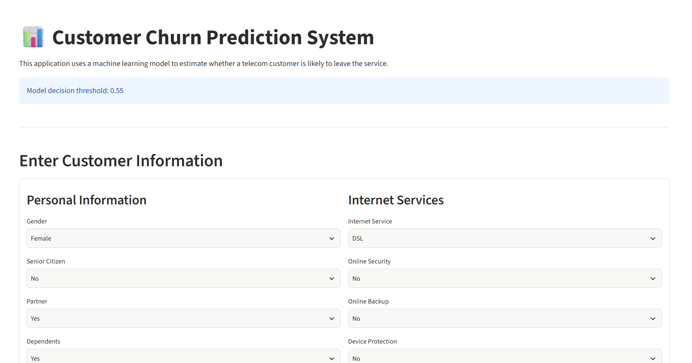
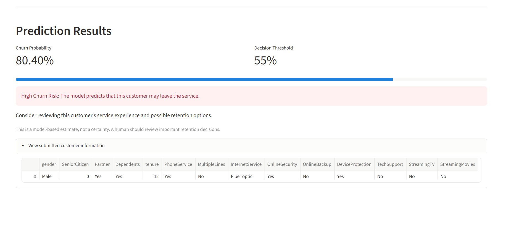
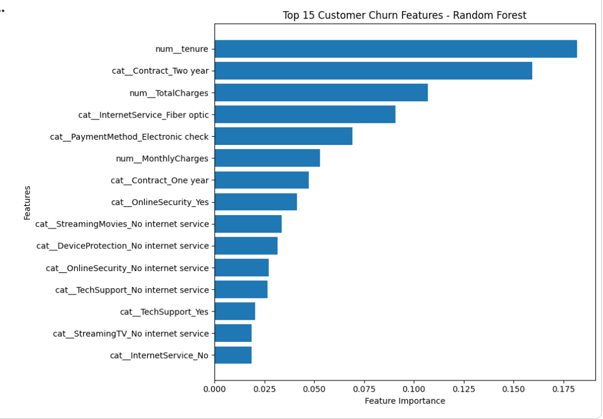

# Customer Churn Prediction System

A machine learning project that predicts whether a telecom customer is likely to discontinue their service. The project includes data preprocessing, model development, evaluation, explainability and an interactive Streamlit application.

## Project Overview

Customer churn is an important business problem for telecommunications companies. Identifying customers who may leave helps businesses understand retention risks and make informed customer engagement decisions.

This project uses customer demographic, account, service and billing information to estimate churn probability.

## Application Screenshots

### Customer Churn Dashboard


### Prediction Result


### Feature Importance


## Objectives

- Explore and understand telecom customer data.
- Clean and preprocess the dataset.
- Identify important factors associated with customer churn.
- Train and compare machine learning classification models.
- Optimize model hyperparameters and decision threshold.
- Interpret model predictions and feature importance.
- Build an interactive application for customer churn prediction.

## Dataset

**Dataset:** Telco Customer Churn

The dataset contains customer information, including:

- Demographic details
- Account information
- Phone and internet services
- Contract and payment details
- Monthly and total charges
- Churn status

After cleaning, the dataset contained **7,032 records and 21 columns**. The target variable is `Churn`.

## Technologies Used

- Python
- Pandas and NumPy
- Matplotlib and Seaborn
- Scikit-learn
- Joblib
- Streamlit
- Google Colab
- Git and GitHub

## Project Workflow

1. Data loading and exploratory data analysis
2. Missing-value and duplicate handling
3. Categorical and numerical feature identification
4. Feature preprocessing and encoding
5. Training and testing data separation
6. Model development and comparison
7. Hyperparameter optimization using cross-validation
8. Decision-threshold tuning
9. Model evaluation and interpretation
10. Model serialization using Joblib
11. Interactive application development using Streamlit

## Models Evaluated

- Logistic Regression
- Decision Tree Classifier
- Random Forest Classifier

The models were compared using accuracy, precision, recall, F1-score and ROC-AUC. Hyperparameter optimization and threshold selection were used to improve churn detection.

## Final Model Performance

The selected tuned model was evaluated on a held-out test set of 1,407 customers.

| Metric | Test Result |
|---|---:|
| Accuracy | 75.41% |
| Churn Precision | 52% |
| Churn Recall | 79% |
| Churn F1-score | 63% |
| ROC-AUC | 0.8487 |
| Decision Threshold | 0.55 |

The selected threshold prioritizes identifying more customers who may churn. This increases churn detection compared with the default threshold, while also producing additional false positives.

## Key Features

- Interactive customer information form
- Churn probability estimation
- Configurable model decision threshold stored with the model
- High-risk and lower-risk classification
- Customer input summary
- Machine learning pipeline integration

## Run the Application Locally

### 1. Clone the repository

```bash
git clone https://github.com/jatin-kumar-creator/machine-learning-portfolio.git
```

### 2. Navigate to the project directory

```bash
cd machine-learning-portfolio/projects/01_customer_churn
```

### 3. Create and activate a virtual environment

```bash
python -m venv venv
```

Windows:

```bash
venv\Scripts\activate
```

### 4. Install dependencies

```bash
pip install -r requirements.txt
```

### 5. Run Streamlit

```bash
streamlit run app.py
```

The application will open in your browser.

## Project Structure

```text
01_customer_churn/
├── assets/
├── models/
│   └── customer_churn_model.pkl
├── notebooks/
├── reports/
├── screenshots/
├── src/
├── app.py
├── requirements.txt
└── README.md
```

## Limitations

- Predictions depend on the quality and representativeness of the training dataset.
- Model probabilities are estimates, not guarantees of customer behavior.
- A lower decision threshold can increase false-positive predictions.
- The model should be validated on new customer data before business deployment.

## Future Improvements

- Add batch customer churn prediction.
- Develop a customer retention recommendation module.
- Improve model monitoring and evaluation.
- Deploy the application on a persistent hosting platform.
- Add automated reporting and business analytics.

## Disclaimer

This project is developed for educational and portfolio purposes. Predictions should support, not replace, human judgment in customer retention decisions.
