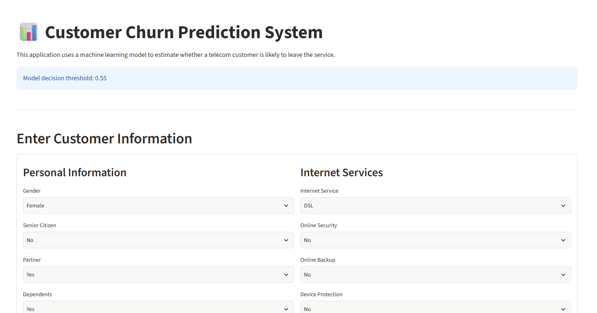
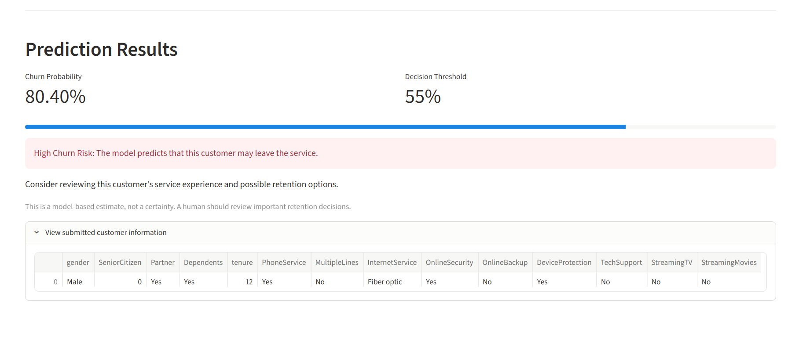
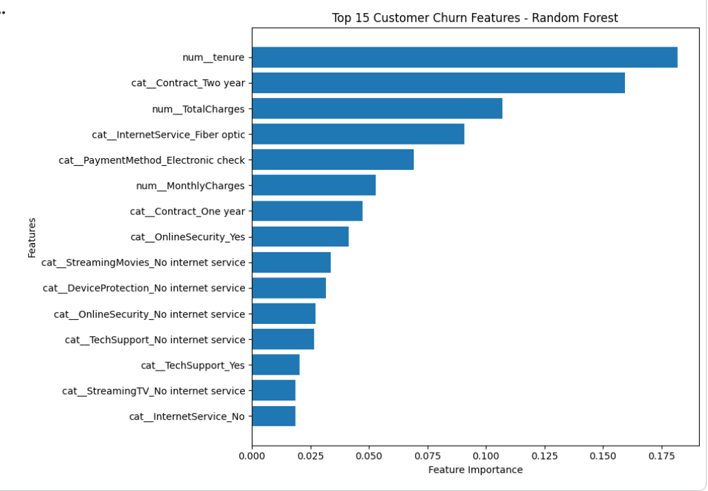

# Customer Churn Prediction System
## Technical Project Report

**Project Category:** Machine Learning – Supervised Classification  
**Domain:** Telecommunications  
**Target Variable:** Churn  
**Primary Objective:** Identify customers who are likely to discontinue their telecom services.

---

## 1. Executive Summary

This project develops a machine learning-based Customer Churn Prediction System using telecom customer data.

The objective is to identify customers who may discontinue their services by analyzing demographic information, service subscriptions, account details and billing behavior.

Multiple classification algorithms were developed and evaluated. Hyperparameter optimization, cross-validation and decision-threshold tuning were applied to improve churn detection.

A Streamlit application was developed to allow users to enter customer information and receive a churn probability estimate.

## 2. Dataset Description

**Dataset:** Telco Customer Churn

| Attribute | Description |
|---|---|
| Original records | 7,043 |
| Records after cleaning | 7,032 |
| Original columns | 21 |
| Features | 19 |
| Target | Churn |

The dataset contains customer demographic, service, contract and billing information.

### Target Distribution

| Customer Category | Records |
|---|---:|
| No Churn | 5,163 |
| Churn | 1,869 |
| Total | 7,032 |

The dataset contains an imbalanced target distribution, with fewer customers belonging to the churn category.

## 3. Data Cleaning and Preprocessing

The following preprocessing activities were performed:

1. Inspected dataset dimensions and data types.
2. Examined missing values.
3. Identified 11 missing values in `TotalCharges`.
4. Observed that all 11 records had a tenure value of zero.
5. Removed these 11 incomplete records.
6. Checked for duplicate records.
7. Examined numerical and categorical features.
8. Separated input features and target variable.

After cleaning, the dataset contained 7,032 records with no missing values or duplicate records.

### Feature Separation

- Input features (X): 19
- Target variable (y): 1

The dataset was divided into training and testing sets using stratified sampling.

| Dataset | Records |
|---|---:|
| Training | 5,625 |
| Testing | 1,407 |

Stratification maintained approximately the same churn distribution in both subsets.

## 4. Machine Learning Models

Three classification algorithms were evaluated:

### 4.1 Logistic Regression

Used as a baseline classification algorithm to estimate the probability of customer churn.

### 4.2 Decision Tree Classifier

Used to model nonlinear relationships and decision rules between customer attributes and churn.

### 4.3 Random Forest Classifier

Used an ensemble of decision trees to capture more complex relationships and improve predictive performance.

## 5. Model Evaluation

The models were evaluated using:

- Accuracy
- Precision
- Recall
- F1-score
- ROC-AUC
- Confusion Matrix

Recall was particularly important because identifying customers who may churn is a key project objective.

### Initial Model Comparison

| Model | Accuracy | Precision | Recall | F1-score | ROC-AUC |
|---|---:|---:|---:|---:|---:|
| Logistic Regression | 80.53% | 65.15% | 57.49% | 61.08% | 0.8361 |
| Decision Tree | 71.64% | 46.61% | 45.99% | 46.30% | 0.6343 |
| Random Forest | 78.68% | 62.25% | 50.27% | 55.62% | 0.8172 |

Logistic Regression performed best among these initial models based on accuracy and ROC-AUC.

## 6. Hyperparameter Optimization

Hyperparameter tuning was performed using cross-validation and parameter search.

The optimization objective emphasized recall to improve the detection of customers belonging to the churn class.

Class weighting was also considered to address the imbalance between churn and non-churn customers.

## 7. Decision Threshold Optimization

The default classification threshold of 0.50 was evaluated alongside alternative thresholds.

A threshold of 0.55 was selected using validation data to balance precision and recall.

The final classification rule was:

- Probability greater than or equal to 0.55: Churn
- Probability below 0.55: No Churn

Threshold selection affects the balance between false positives and false negatives. It should therefore reflect the business objective.

## 8. Final Model Evaluation

The selected tuned Logistic Regression pipeline was evaluated on the held-out test set.

| Metric | Final Result |
|---|---:|
| Accuracy | 75.41% |
| Churn Precision | 52% |
| Churn Recall | 79% |
| Churn F1-score | 63% |
| ROC-AUC | 0.8487 |
| Decision Threshold | 0.55 |

### Confusion Matrix

| | Predicted No Churn | Predicted Churn |
|---|---:|---:|
| Actual No Churn | 765 | 268 |
| Actual Churn | 78 | 296 |

### Interpretation

- 296 actual churn customers were correctly identified.
- 78 actual churn customers were missed.
- 268 non-churn customers were incorrectly flagged as churn risks.
- 765 non-churn customers were correctly identified.

The model achieved approximately 79% recall for the churn class, indicating that it identified a substantial proportion of customers who actually churned.

However, churn precision was approximately 52%, meaning that a considerable number of customers flagged as high-risk did not actually churn.

## 9. Feature Importance and Model Interpretation

Feature importance and explainability techniques were used to understand the factors associated with customer churn.

The analysis highlighted variables such as:

- Customer tenure
- Contract type
- Internet service
- Total charges
- Monthly charges
- Payment method
- Online security
- Technical support

The Random Forest feature-importance analysis and permutation-importance analysis provided different perspectives on feature contribution.

SHAP was also used to examine how individual feature values influenced model predictions.

These results describe associations learned by the model; they do not establish that a feature causes customer churn.

## 10. Streamlit Application

An interactive application was developed using Streamlit.

### Application Capabilities

- Customer demographic inputs
- Phone and internet service information
- Contract and billing information
- Churn probability estimation
- Risk classification using the selected threshold
- Submitted customer information display

The application loads the serialized machine learning artifact using Joblib.

### Application Screenshots

#### Customer Dashboard



#### Prediction Result



#### Feature Importance



## 11. Model Deployment and Execution

The application uses the following technologies:

- Python
- Scikit-learn
- Joblib
- Pandas
- Streamlit

To run the application locally:

```bash
pip install -r requirements.txt
streamlit run app.py
```

The trained model is stored in the `models/` directory.

## 12. Limitations

1. Model performance depends on the quality and representativeness of the dataset.
2. The selected threshold prioritizes churn recall but produces false-positive predictions.
3. The dataset represents historical customer behavior and may not reflect future market conditions.
4. Probability estimates should not be interpreted as guaranteed outcomes.
5. Additional validation on new customer data is necessary before real-world deployment.

## 13. Future Improvements

- Add batch prediction for multiple customers.
- Develop customer retention recommendation capabilities.
- Monitor model performance over time.
- Evaluate additional classification algorithms.
- Improve probability calibration.
- Deploy the application on persistent cloud infrastructure.
- Integrate business analytics and automated reports.

## 14. Conclusion

The project demonstrates an end-to-end machine learning workflow for telecom customer churn prediction.

It covers data cleaning, exploratory analysis, feature preprocessing, classification, hyperparameter optimization, threshold tuning, model evaluation, explainability and interactive application development.

The final model achieved approximately 75.41% test accuracy, 79% churn recall and 0.8487 ROC-AUC using a 0.55 decision threshold.

The resulting application provides an interactive way to estimate customer churn risk and demonstrates how machine learning can support customer retention analysis.

---

**Project Status:** Functional prototype developed for educational and portfolio purposes.
